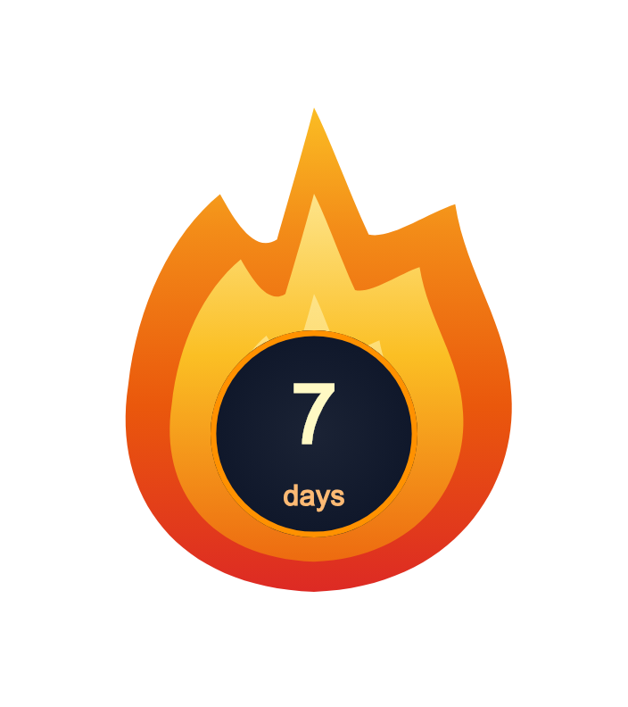
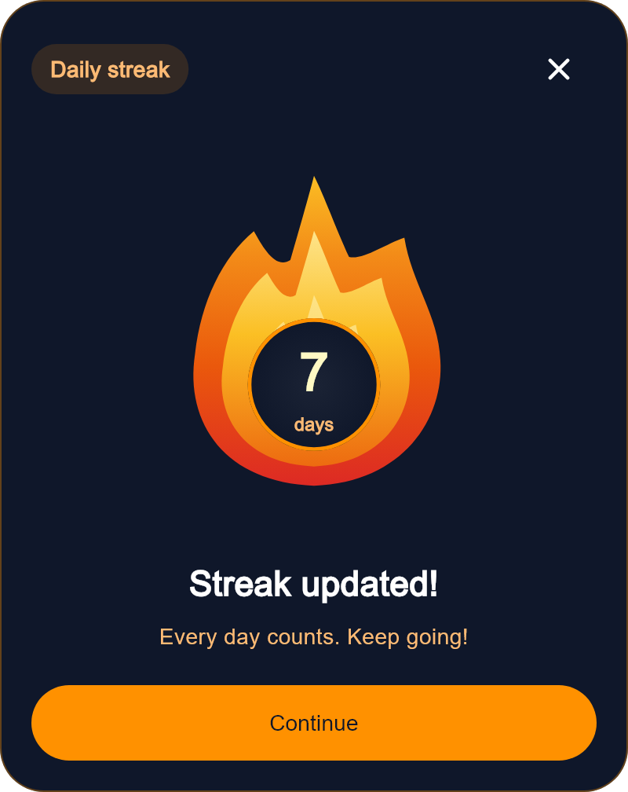
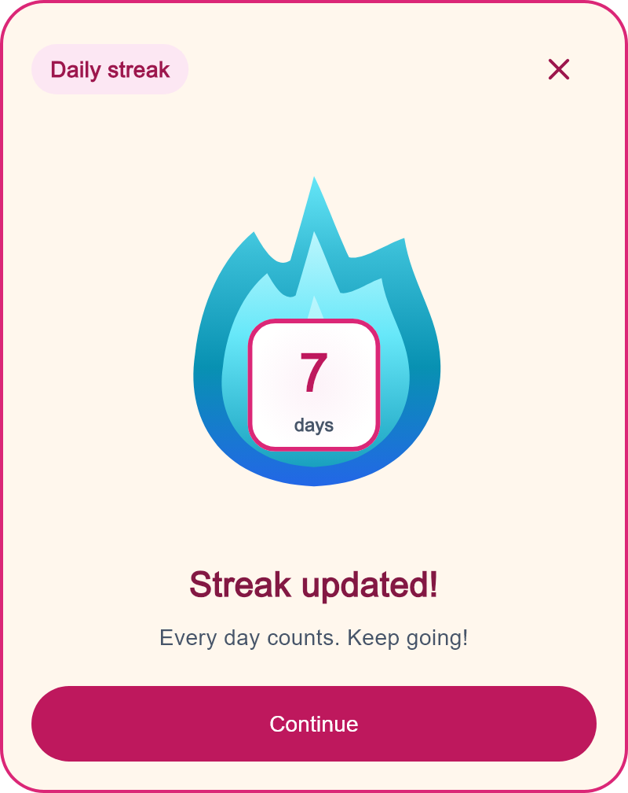
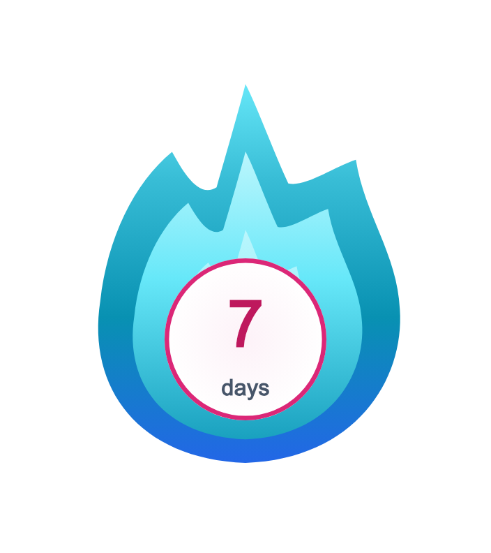

# streak_flame

An animated streak flame and celebration dialog for Flutter. Use it in habit,
learning, fitness, or productivity apps: your application supplies the counts,
and the package handles presentation.



**Release candidate:** not published yet. The selected public package name
is streak_flame, licensed under MIT. The default presentation keeps the red/orange
flame.

## Run and edit independently

Clone the repository and open it as its own workspace. The example uses only
the local package at path: ../ and the Flutter SDK.
[Start here (Arabic)](START_HERE.md) explains setup, editing, tests, and transport.

```sh
git clone https://github.com/ZakariaEysa/streak_flame.git
cd streak_flame
flutter pub get
cd example
flutter pub get
flutter run -d chrome
```

VS Code launch configurations and tasks are included. On Windows, run
tool/playground.ps1 for Chrome, use -Action check -BuildWeb for verification,
or -Action pack to create build/portable/streak_flame.zip.
The ZIP omits generated caches and machine-specific SDK configuration.

The default example opens a plain package preview with no settings panel.
Edit the clearly named values and Arabic comments in
example/lib/streak_preview_page.dart, then hot reload.
For the optional interactive playground, run from example:
flutter run -t lib/playground_main.dart -d chrome.

## Install locally

Until the package is published, add a path dependency to the consuming app:

```yaml
dependencies:
  streak_flame:
    path: ../streak_flame
```

The path above assumes a sibling clone named streak_flame; adjust it to wherever
you keep the package. The Dart package name and public import are streak_flame
regardless of the folder name.

Requires Dart 3.10+ and Flutter 3.38+. Runtime dependencies: Flutter SDK only.
No Firebase, Cubit, API, localization library, images, or remote fonts.

## One widget, two presentations

Only oldStreak and newStreak are required. The default is the flame and count
badge. Use display: StreakDisplay.celebration for the full card inside your page:

```dart
StreakWidget(
  oldStreak: 6,
  newStreak: 7,
  display: StreakDisplay.celebration,
  onContinue: () {},
  onClose: () {},
);
```

To open the same content as a popup, call StreakWidget.showCelebration(context,
oldStreak: 6, newStreak: 7). Popup actions dismiss automatically; inline actions
call your callbacks. Inline Continue is disabled without onContinue; Close is
omitted without onClose.

Appearance is optional and divided by scope:

| Option | Scope |
| --- | --- |
| palette | Flame layers, gradients, halo, particles, badge colors and shared fallbacks |
| flameStyle | Outer flame outline and effect geometry |
| badgeStyle | Count badge shape, border, size, offset, padding and shadows |
| celebrationStyle | Outer card, header, title/subtitle, close control and action |
| numberStyle / unitStyle | Badge typography |
| strings / header / footer | Messages and replacement header/action widgets |

[Complete customization guide (Arabic)](doc/CUSTOMIZATION.md) explains every
color, shape, border, gradient, override precedence, and defaults with examples.
BigStreakFlameWidget and StreakCelebrationDialog remain compatibility APIs.
StreakCelebrationStyle also accepts optional card/header/text/closeButton/action
groups. Supplied grouped properties override matching flat options; omitted
properties keep existing defaults. [Package structure](doc/ARCHITECTURE.md)
describes the shared presentation, validation and animation boundaries.




## Basic usage

```dart
import 'package:streak_flame/streak_flame.dart';

const StreakWidget(
  oldStreak: 6,
  newStreak: 7,
  size: 220,
);
```

The original layered flame, pulsing halo, burst, and count transition are drawn
in code. Changing oldStreak or newStreak restarts an automatic transition.
Equal counts display a static number while the flame flickers.

size is the preferred flame width, not the entire canvas: at size 220 the
composition is 352 × 396 logical pixels, including space for particles. A bounded
parent shrinks the whole composition to fit without overflowing. Text scales
with the host settings, then fits within the badge. Screen readers receive one
stable target-count label rather than every animated frame.

## Customize appearance and language

```dart
StreakWidget(
  oldStreak: 1,
  newStreak: 2,
  palette: const StreakPalette(
    flameBase: Color(0xFF2563EB),
    flameMiddle: Color(0xFF0891B2),
    flameTip: Color(0xFF67E8F9),
    flameCore: Color(0xFFECFEFF),
    accent: Color(0xFF22D3EE),
  ),
  strings: const StreakStrings(day: 'يوم', days: 'أيام'),
  numberFormatter: (count) => count == 2 ? '٢' : '١',
  unitLabelBuilder: (count) => count == 2 ? 'يومين' : 'يوم',
);
```

The number formatter above is deliberately a small example; use your app's
formatter for arbitrary numbers. unitLabelBuilder supports language-specific
plural rules. Directionality is inherited from your app. Override semanticsLabel
when you need a more descriptive announcement.

Other appearance options: numberStyle, unitStyle, showGlow, showParticles, and
particleCount (0–64). StreakPalette also exposes surface, foreground, and
secondaryForeground. Localize every dialog label through StreakStrings.

## Independent flame and badge colors



Use the same palette on the flame or the celebration dialog. The flame, badge,
halo, and particles can each have their own colors:

```dart
const customPalette = StreakPalette(
  flameBase: Color(0xFF2563EB),
  flameMiddle: Color(0xFF0891B2),
  flameTip: Color(0xFF67E8F9),
  flameCore: Color(0xFFECFEFF),
  flameGlow: Color(0x6622D3EE), // Alpha controls glow strength.
  flameGlowSecondary: Color(0x222563EB),
  particlePrimary: Colors.cyan,
  particleSecondary: Colors.pink,
  badgeBackground: Colors.white,
  badgeHighlight: Color(0xFFFDF2F8),
  badgeBorder: Color(0xFFDB2777),
  badgeGlow: Color(0x66DB2777),
  badgeOldNumber: Color(0xFF475569),
  badgeNumber: Color(0xFFBE185D),
  badgeLabel: Color(0xFF475569),
);

const StreakWidget(
  oldStreak: 6,
  newStreak: 7,
  palette: customPalette,
);
```

For complete control of gradient colors, stops, direction, and type, supply
outerFlameGradient, middleFlameGradient, innerFlameGradient, or badgeGradient.
For example:

```dart
final theme = customPalette.copyWith(
  outerFlameGradient: const LinearGradient(
    begin: Alignment.bottomCenter,
    end: Alignment.topCenter,
    colors: [Colors.indigo, Colors.blue, Colors.cyan],
    stops: [0, 0.6, 1],
  ),
  badgeGradient: const RadialGradient(
    colors: [Colors.white, Color(0xFFFCE7F3)],
  ),
);
```

A layer gradient takes precedence over that layer's default flame colors.
badgeGradient takes precedence over badgeBackground and badgeHighlight.
Directional gradient alignments follow your app's RTL/LTR setting.

Use copyWith to replace selected values, then rebuild with the new palette.
Color changes do not restart the count transition. Null copyWith arguments retain
existing values; construct a new StreakPalette to remove an override.

Omitted overrides keep the original design and shared palette fallbacks.
Badge overrides do not change the dialog's surface or text colors. Set badgeGlow
or badgeBorder to Colors.transparent to hide them; showGlow controls the flame
halo. Effect colors retain their alpha, and particles also fade during the burst.
Partial numberStyle / unitStyle overrides keep the palette color; an explicit
TextStyle.color takes precedence.
## Increase and restart messages

The dialog automatically uses restart wording when newStreak is lower than
oldStreak (for example, 12 to 1 or 12 to 0). Increases and equal counts keep the
existing positive wording. The package does not detect missed days or calculate
streaks; that remains the host app's responsibility.

Set isStreakReset: true on the dialog or show helper when your app knows a streak
was lost even if the provided counts do not decrease (for example, 0 to 1).
Set it false to keep positive wording for a count correction. Leave it null
for automatic count comparison.

Customize both sets of titles and supporting text:

```dart
await StreakCelebrationDialog.show(
  context,
  oldStreak: 12,
  newStreak: 1,
  strings: const StreakStrings(
    title: 'Keep it going!',
    updatedTitle: 'Another day completed!',
    subtitle: 'You are building a great habit.',
    resetTitle: 'Ready for a fresh start?',
    resetUpdatedTitle: 'Your comeback starts today!',
    resetSubtitle: 'One day at a time. You can do this.',
  ),
);
```

title / resetTitle are used before the transition, updatedTitle /
resetUpdatedTitle afterward, and subtitle / resetSubtitle throughout. Disabled
animations and reduced motion use the completed title immediately. You can
translate every message through the same StreakStrings constructor. Restart
wording does not change the animation; configure particles and colors separately.
## Animation controls

```dart
final controller = StreakAnimationController();

StreakWidget(
  oldStreak: 6,
  newStreak: 7,
  autoStart: false,
  controller: controller,
  transitionDuration: const Duration(milliseconds: 1000),
);

controller.replay(); // Starts immediately and clears explicit pause.
controller.pause();
controller.resume();

// In the owning State.dispose():
controller.dispose();
```

Without autoStart, the starting count remains visible until replay. Control
commands apply to currently mounted widgets. A shared controller can coordinate
multiple flames. Dispose the controller in its owner.

- transitionDelay controls automatic starts; replay skips the delay.
- idleDuration controls flickering. idleAnimationEnabled: false stops idle work.
- animationsEnabled: false displays the final state immediately.
- Reduced-motion preferences are honored by default. respectReducedMotion on the
  flame can be disabled explicitly when the host needs different behavior.
- TickerMode and app lifecycle pause motion. Delayed starts wait for visibility;
  when resumed, a pending automatic start uses the full configured delay.
- onTransitionComplete fires once per completed transition, including immediate
  reduced-motion completion. It never fires after widget disposal.
- enableHaptics is opt-in, may be unavailable on a platform, and has no effect
  in reduced-motion mode.

A widget still mounted in an offscreen scroll area does not automatically become
hidden. Use TickerMode(enabled: false) for such content, or disable idle motion.
Do not call pumpAndSettle in tests with an indefinitely flickering flame; use
controlled pump durations or turn idle motion off.

## Celebration dialog

```dart
await StreakCelebrationDialog.show(
  context,
  oldStreak: 6,
  newStreak: 7,
  strings: const StreakStrings(button: 'Keep going'),
  maxWidth: 400,
  onDismiss: () {},
);
```

The dialog scrolls in short viewports and at large text scales, supports inherited
RTL, and uses standard focusable Material buttons. It accepts the same palette,
count formatters, motion switches, and particle settings as the flame.
Replace header or footer with custom widgets. When replacing the header, supply
your own close action if needed.

The helper supports barrierDismissible, useRootNavigator, barrierColor, and
optional blurSigma (default 0). onDismiss runs after close, action, back, or
barrier dismissal. You can also embed StreakCelebrationDialog directly.

## Example and validation

From the package directory:

```sh
flutter pub get
flutter analyze --no-pub
flutter test --no-pub test/streak_widget_test.dart test/streak_dialog_test.dart test/streak_messages_test.dart test/streak_palette_test.dart test/streak_playground_test.dart test/visual_preview_test.dart
cd example
flutter run -d chrome
```

The example offers replay, pause, next-day updates, restarts, theme switching, RTL, and
motion toggles, custom messages, editable counts, size/timing/particle sliders, reduced motion, and text scaling. Flame and badge themes can be switched independently. Host files are included for web, Android, iOS, Windows, Linux, and macOS; native builds require each platform toolchain.

See [publication steps](PUBLISHING.md) and
[performance measurement notes](doc/PERFORMANCE.md).

## Contact

Report bugs and request features through
[GitHub Issues](https://github.com/ZakariaEysa/streak_flame/issues).

For questions, feedback, or support, contact **ZakariaEysa** at
[zakariaeysa@gmail.com](mailto:zakariaeysa@gmail.com).

## License

Maintained by **ZakariaEysa**. Copyright (c) 2026 ZakariaEysa.

This package is distributed under the [MIT License](LICENSE).
