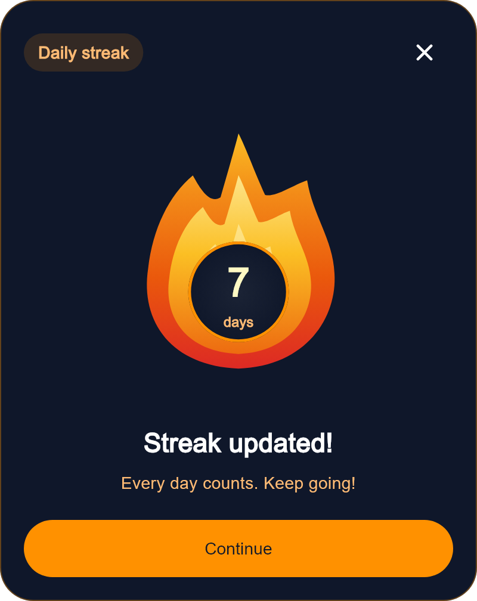
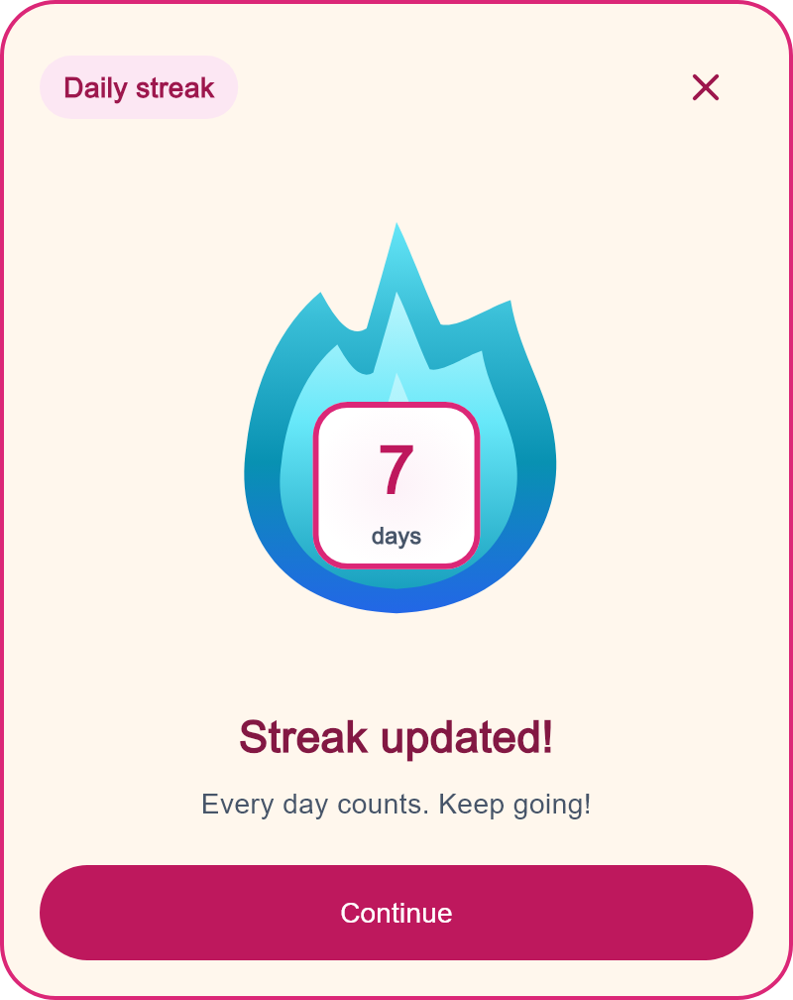

# تخصيص الشعلة والبادج والاحتفال

الواجهة الجديدة هي `StreakWidget`. المطلوب بس `oldStreak` و`newStreak`؛
الألوان والأشكال والنصوص والأنيميشن كلها اختيارية. لو مش مرّرت إعدادات،
هتاخد الشكل الافتراضي والبادج في موضعها المصحح في منتصف جسم الشعلة.

## اختيار الشكل

```dart
// الشعلة والبادج فقط؛ ده الاختيار الافتراضي.
const StreakWidget(oldStreak: 6, newStreak: 7);

// نفس الشعلة داخل كارت الاحتفال الكامل في الصفحة.
StreakWidget(
  oldStreak: 6,
  newStreak: 7,
  display: StreakDisplay.celebration,
  onContinue: () { /* التصرف اللي انت عايزه */ },
  onClose: () { /* اخفي الويدجت أو غيّر display عندك */ },
);

// نفس الاحتفال كـpopup؛ أزراره بتقفله تلقائيًا.
await StreakWidget.showCelebration(
  context,
  oldStreak: 6,
  newStreak: 7,
  onContinue: () { /* بعد طلب إغلاق الـpopup */ },
  onDismiss: () { /* بعد أي إغلاق، بما فيه back وbarrier */ },
);
```

الاحتفال داخل الصفحة ما بيعملش navigation تلقائيًا.
لو مش مرّرت `onContinue`، زر المتابعة هيبقى disabled.
لو مش مرّرت `onClose`، زر الإغلاق مش هيظهر.
الـpopup بيوفر التصرفين تلقائيًا. استخدم `showAction: false` لإخفاء زر المتابعة.

`BigStreakFlameWidget` و`StreakCelebrationDialog` لسه موجودين للتوافق مع الكود القديم؛
كلهم بيستخدموا نفس تنفيذ الشعلة. الواجهة المقترحة للكود الجديد هي `StreakWidget`.

## كل مجموعة بتغيّر إيه؟

| الباراميتر | الجزء اللي بيعدّله |
| --- | --- |
| `palette` | ألوان الشعلة وطبقاتها والجزيئات والبادج، مع ألوان مشتركة افتراضية |
| `flameStyle` | حدود جسم الشعلة، نصف قطر الهالة، وحجم الجزيئات |
| `badgeStyle` | البادج اللي فيها الرقم: شكلها، حدودها، حجمها، مكانها، padding والظل |
| `celebrationStyle` | الكارت الخارجي والهيدر والعناوين وزر الإغلاق وزر المتابعة |
| `numberStyle` / `unitStyle` | خط الرقم ووحدة الأيام داخل البادج |
| `strings` | كل الرسائل وعناوين الزيادة والبداية من جديد وتسميات الأزرار |
| `header` / `footer` | استبدال الهيدر أو زر المتابعة بويدجت من عندك |

`celebrationStyle` و`header` و`footer` بتظهر مع `celebration` بس.
تخصيص الشعلة والبادج بيشتغل مع الشكلين ومع الـpopup.

## palette: ألوان الشعلة

| الحقل | وظيفته |
| --- | --- |
| `flameBase` | أسفل الطبقة الخارجية |
| `flameMiddle` | وسط الشعلة وأسفل الطبقة الوسطى |
| `flameTip` | رأس الشعلة |
| `flameCore` | الطبقة الداخلية؛ كمان لون الرقم الجديد الافتراضي |
| `outerFlameGradient` / `middleFlameGradient` / `innerFlameGradient` | استبدال تدرّج كل طبقة بالكامل، بما فيه الألوان والاتجاه والـstops |
| `flameGlow` / `flameGlowSecondary` | لونا الهالة المحيطة؛ alpha بيتحكم في شدة اللون |
| `particlePrimary` / `particleSecondary` | لونا جزيئات الاحتفال |

`showGlow: false` بيخفي هالة الشعلة.
`showParticles: false` بيخفي الجزيئات. `particleCount` من 0 إلى 64.

## palette: ألوان البادج

| الحقل | وظيفته |
| --- | --- |
| `badgeBackground` / `badgeHighlight` | خلفية البادج ولون مركز التدرّج |
| `badgeGradient` | تدرّج البادج بالكامل؛ يغلب الخلفية والـhighlight |
| `badgeBorder` | لون حدود الدائرة الافتراضية |
| `badgeGlow` | لون ظل البادج؛ مستقل عن هالة الشعلة |
| `badgeOldNumber` / `badgeNumber` | لون الرقم القديم والجديد |
| `badgeLabel` | لون كلمة يوم/أيام |

لو عايز خلفية مسطحة تمامًا، مرّر نفس اللون للـbackground والـhighlight أو
استخدم `badgeGradient` بلونين متساويين. `badgeStyle.shadows: const []` يلغي ظل البادج.

ألوان مشتركة بتستخدم لما مفيش override خاص:
`accent` للحدود والتوهج والزر، `surface` للخلفيات،
`foreground` للنص الأساسي، `secondaryForeground` للنص الفرعي.
لو عايز أجزاء مستقلة، استخدم حقول `badge*` وإعدادات `celebrationStyle` بدل الألوان المشتركة.

## flameStyle: حدود وتأثيرات الشعلة

| الحقل | الافتراضي / الوظيفة |
| --- | --- |
| `borderColor` / `borderWidth` | لون وعرض حدود جسم الشعلة؛ العرض 0 افتراضيًا، فالحدود مخفية |
| `strokeJoin` | اتصال زوايا الحدود؛ round افتراضيًا |
| `glowRadius` | نصف قطر الهالة؛ 98، و0 يخفيها |
| `particleSize` | معامل حجم الجزيئات؛ 1، و0 يخفيها |

مسار الشعلة نفسه هو التصميم الأصلي. تخصيص شكله المرسوم يتم في
`lib/src/streak_flame_painter.dart` أثناء تطوير الباكدج.

## badgeStyle: شكل البادج

| الحقل | الافتراضي / الوظيفة |
| --- | --- |
| `size` | 116؛ قطر الدائرة أو طول ضلع الشكل |
| `offset` | Offset.zero؛ إزاحة من المركز المصحح |
| `shape` | اختياري؛ أي ShapeBorder مثل RoundedRectangleBorder أو StadiumBorder |
| `borderWidth` / `borderStyle` | 3.2 / solid للدائرة الافتراضية؛ 0 أو none يخفي الحدود |
| `padding` | 14 حول النص |
| `shadows` | قائمة ظلال بديلة؛ [] لإخفائها |
| `glowBlurRadius` / `glowSpreadRadius` / `glowOffset` | 12 / 0 / Offset.zero للظل الافتراضي |

لما تمرّر `shape`، حدّد حدودها في `shape.side`؛ ساعتها الشكل المخصص
بيغلب `badgeBorder` و`borderWidth` و`borderStyle`.
أبعاد البادج وحدود الشعلة وتأثيراتها بوحدات التصميم عند `size: 220`،
وبتصغر وتكبر مع حجم الشعلة. مساحة الرسم كاملة عند الحجم ده 352×396.

## مجموعات أوضح لتنسيق الاحتفال

تقدر تستخدم مجموعات اختيارية بدل كتابة كل إعدادات الاحتفال في قائمة واحدة.
الباراميترز القديمة لسه شغّالة، ومش محتاج تغيّر صفحة تجربتك.

```dart
const celebrationAppearance = StreakCelebrationStyle(
  card: StreakCardStyle(
    backgroundColor: Color(0xFF0F172A),
    borderColor: Colors.orange,
    borderWidth: 2,
  ),
  header: StreakHeaderStyle(
    backgroundColor: Color(0x26FF9100),
    foregroundColor: Colors.orange,
  ),
  text: StreakTextStyle(
    titleColor: Colors.white,
    subtitleColor: Colors.orange,
  ),
  closeButton: StreakCloseStyle(foregroundColor: Colors.white),
  action: StreakActionStyle(
    backgroundColor: Colors.orange,
    foregroundColor: Colors.black,
  ),
);
```

| مجموعة داخل celebrationStyle | مسؤوليتها |
| --- | --- |
| `card` | خلفية الكارت وحدوده وشكله وظلاله والمسافات |
| `header` | الهيدر الصغير وشكله ونصه وظهوره |
| `text` | العنوان والوصف وخطوطهم ومحاذاتهم والمسافة بينهم |
| `closeButton` | زر الإغلاق وألوانه وحدوده وحجمه وظهوره |
| `action` | زر المتابعة وألوانه وحدوده وخطه ومسافاته وظهوره |

كل حقل جوّه المجموعة اختياري. لو مرّرت `card.borderColor` مثلًا، بيغلب
`borderColor` القديم؛ لو سبت `card.padding` فارغ، يستخدم `padding` القديم
أو الافتراضي. إزالة override بتتم بإنشاء إعدادات جديدة من غيره.
قراءة الإعدادات ما بتنشئش objects جديدة مع كل frame.


## celebrationStyle: الشكل الخارجي فقط

| الجزء | الحقول |
| --- | --- |
| الكارت | `backgroundColor`, `backgroundGradient`, `borderColor`, `borderWidth`, `borderRadius`, `shape`, `shadows` |
| المسافات | `padding`, `margin`, `dialogInsetPadding`, `titleSubtitleSpacing`, `actionSpacing` |
| هيدر Daily streak | `headerBackgroundColor`, `headerGradient`, `headerForegroundColor`, `headerBorderColor`, `headerBorderWidth`, `headerBorderRadius`, `headerShape`, `headerPadding`, `headerTextStyle` |
| زر الإغلاق | `closeColor`, `closeBackgroundColor`, `closeBorderColor`, `closeBorderWidth`, `closeShape`, `closeIconSize`, `closeButtonStyle` |
| العنوان والوصف | `titleColor`, `subtitleColor`, `titleStyle`, `subtitleStyle`, `textAlign` |
| زر المتابعة | `buttonBackgroundColor`, `buttonForegroundColor`, `buttonDisabledBackgroundColor`, `buttonDisabledForegroundColor`, `buttonOverlayColor`, `buttonBorderColor`, `buttonBorderWidth`, `buttonShape`, `buttonPadding`, `buttonMinimumSize`, `buttonTextStyle`, `buttonStyle` |
| إظهار أجزاء | `showHeader`, `showCloseButton`, `showAction`؛ true افتراضيًا |

`maxWidth` على الويدجت نفسها يحدد أقصى عرض للكارت، وافتراضيًا 400.
الـpopup يستخدم `dialogInsetPadding`؛ الوضع داخل الصفحة يستخدم `margin`.
الكارت قابل للـscroll لما ارتفاع المساحة قليل.

أولوية التخصيص:
- تدرّج الخلفية يغلب لونها.
- `shape` و`headerShape` يشملوا حدودهم ويغلبوا إعدادات الحدود والزوايا المنفصلة.
- حدود `buttonShape` و`closeShape` تتحكم فيها حقول border المنفصلة؛ أو مرّر ShapeBorder مع side من خلال `buttonStyle` / `closeButtonStyle`.
- لون صريح في TextStyle يغلب لون النص العادي. إعدادات ButtonStyle المتقدمة تغلب الحقول البسيطة غير الفارغة، وتدعم pressed/hover/focus/disabled.
- القوائم والـgradients الممرّرة لازم تفضل immutable؛ للتغيير أثناء التشغيل، اعمل object جديد.

## مثال: شعلة زرقاء، بادج أبيض، وكارت وردي

```dart
StreakWidget(
  oldStreak: 6,
  newStreak: 7,
  display: StreakDisplay.celebration,
  palette: const StreakPalette(
    flameBase: Colors.blue,
    flameMiddle: Colors.cyan,
    flameTip: Color(0xFF67E8F9),
    flameCore: Colors.white,
    badgeBackground: Colors.white,
    badgeHighlight: Colors.white,
    badgeNumber: Colors.pink,
    badgeLabel: Colors.blueGrey,
    badgeGlow: Colors.transparent,
  ),
  flameStyle: const StreakFlameStyle(
    borderColor: Colors.cyanAccent,
    borderWidth: 2,
  ),
  badgeStyle: const StreakBadgeStyle(
    shape: RoundedRectangleBorder(
      borderRadius: BorderRadius.all(Radius.circular(24)),
      side: BorderSide(color: Colors.pink, width: 4),
    ),
  ),
  celebrationStyle: const StreakCelebrationStyle(
    backgroundColor: Color(0xFFFFF7ED),
    borderColor: Colors.pink,
    borderWidth: 2,
    borderRadius: BorderRadius.all(Radius.circular(16)),
    titleColor: Color(0xFF831843),
    subtitleColor: Colors.blueGrey,
    headerBackgroundColor: Color(0xFFFCE7F3),
    headerForegroundColor: Colors.pink,
    closeColor: Colors.pink,
    buttonBackgroundColor: Colors.pink,
    buttonForegroundColor: Colors.white,
    buttonShape: RoundedRectangleBorder(
      borderRadius: BorderRadius.all(Radius.circular(12)),
    ),
  ),
  onContinue: () {},
  onClose: () {},
);
```




## النصوص والحركة

`strings.title` / `updatedTitle` / `subtitle` للزيادة،
و`resetTitle` / `resetUpdatedTitle` / `resetSubtitle` للبداية من جديد.
النقصان يختار رسائل البداية تلقائيًا؛ `isStreakReset` يقدر يغيّر القرار يدويًا.

`controller` للتحكم في replay/pause/resume، و`autoStart` للتشغيل التلقائي.
`transitionDelay` و`transitionDuration` و`idleDuration` للتوقيت.
`animationsEnabled` و`idleAnimationEnabled` اختياريين،
و`respectReducedMotion` بيحترم إعدادات الجهاز افتراضيًا.
`enableHaptics` مغلق افتراضيًا. صاحب الـcontroller هو اللي يعمل له dispose.

## أجرب منين؟

التشغيل الافتراضي بيفتح صفحة مباشرة بدون إعدادات. عدّل القيم والتعليقات في
`example/lib/streak_preview_page.dart` ثم اعمل hot reload.

لشاشة الإعدادات الاختيارية، شغّل من example:
`flutter run -t lib/playground_main.dart -d chrome`، وفعّل:
- Full celebration preview: الشكل الكامل داخل الصفحة.
- Rounded square badge: تجربة shape وحدود البادج.
- Custom frame / borders: ألوان مستقلة للكارت والهيدر والزر وحدود الشعلة.
- Celebrate: نفس الإعدادات داخل popup.

لقيمك الخاصة، عدّل getters `_palette` و`_flameStyle` و`_badgeStyle`
و`_celebrationStyle` في `example/lib/streak_demo_page.dart`؛
الديمو بيمررهم للويدجت والـpopup. باقي طريقة التشغيل في [START_HERE](../START_HERE.md).
